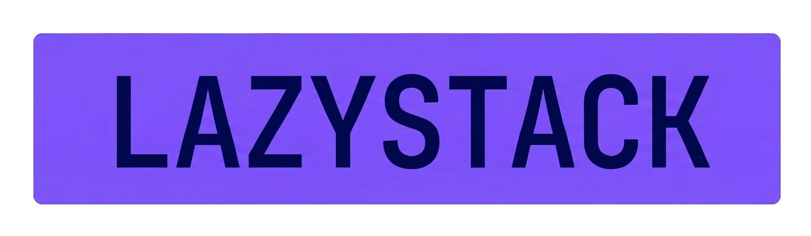
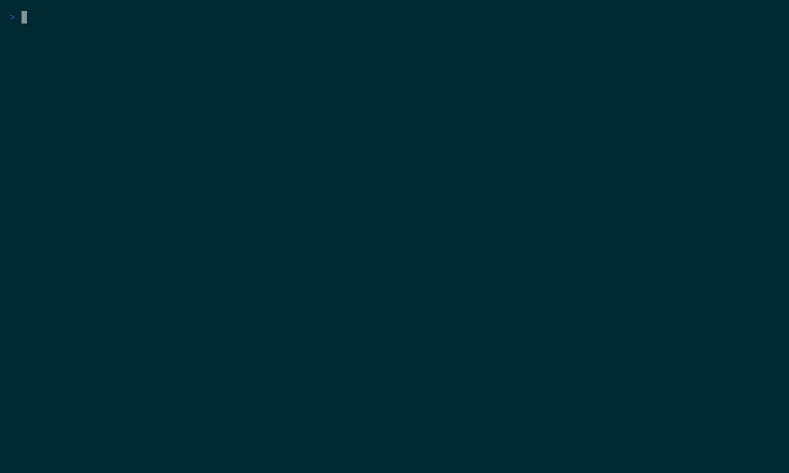

<p align="center">
  
</p>

<p align="center">
  A keyboard-driven terminal UI for OpenStack.
</p>

<p align="center">
  <a href="#installation">Installation</a> &middot;
  <a href="#features">Features</a> &middot;
  <a href="#keybindings">Keybindings</a> &middot;
  <a href="#configuration">Configuration</a> &middot;
  <a href="#license">License</a>
</p>

---

<p align="center">
  
</p>

**lazystack** is a fast, keyboard-first TUI for managing OpenStack resources from the terminal. It follows the "lazy" convention ([lazygit](https://github.com/jesseduffield/lazygit), [lazydocker](https://github.com/jesseduffield/lazydocker)) to provide an intuitive alternative to Horizon and the verbose OpenStack CLI.

Single binary. No runtime dependencies. Reads your standard `clouds.yaml`.

## Features

- **Server management** — list, create, delete, rename, rebuild, reboot, stop/start, pause, suspend, shelve, lock/unlock, rescue/unrescue, resize, snapshot, with bulk operations
- **Volume management** — list, detail, create, delete, attach (server picker), detach, with bulk delete and detach
- **Floating IPs** — allocate (pick the external network when there are several; asks before allocating), associate, disassociate, release
- **Security groups** — create, delete, rename and clone groups; create, edit and delete rules; attached servers and ports panes
- **Networks** — create/delete networks; create, edit and delete subnets (gateway `none` for no gateway) and ports
- **Routers** — create/delete routers, add/remove interfaces (subnet picker), interfaces and routes panes
- **Key pairs** — create (RSA 2048/4096, ED25519), import with ~/.ssh/ file browser, detail view, save private key to file
- **Images** — list, detail, upload, download, edit, delete (bulk), deactivate/reactivate with status-aware coloring
- **Load balancers** (Octavia) — list, detail panes (listeners/pools/members), create/edit/delete listeners, pools, members and health monitors, admin state toggle, member drain, bulk member actions, cascade delete
- **DNS** (Designate) — zones with their records
- **Admin views** — hypervisors, user management (enable/disable, delete), service catalog
- **Audit trail** — actions lazystack performs are recorded locally (on by default) and can be filtered by action, resource or date
- **Project switching** — switch between accessible Keystone projects without restarting
- **Quota overlay** — compute, network, and storage quotas with color-coded progress bars
- **Confirmation dialogs** — server state changes, deletes and admin actions ask first; bulk prompts list the affected servers
- **Create feedback** — the server, volume and key pair create forms report `Created <name>` and highlight the new item in its list
- **Dynamic tabs** — tabs appear based on available services (no Cinder? no Volumes tab)
- **Auto-refresh** — all views refresh in the background at a configurable interval
- **SSH integration** — launch SSH sessions directly from the TUI, or copy the SSH command to clipboard
- **Console access** — retrieve noVNC console URL, open in browser or copy to clipboard
- **Server cloning** — clone servers with one keypress
- **Cross-resource navigation** — jump from server detail to attached volumes, security groups, or networks
- **Console log** and **action history** per server
- **Column sorting** with `s` / `S` on every resource list
- **Client-side filtering** with `/` on every resource list
- **Bulk select** with `space` for servers, volumes, images and load balancer members
- **Rebindable keys** — every action in the keybinding config can be bound to other keys
- **Self-update** — `--update` flag to update to the latest release; the download must match the release's `SHA256SUMS`, which must be signed for that release's tag with the project's release key from v0.20.0 on; older releases fall back to the checksum alone with a warning (see [SECURITY.md](SECURITY.md#release-signing-and-self-update-verification))
- **Solarized Dark** color scheme with status-aware coloring

## Installation

### Homebrew (macOS & Linux)

```bash
brew install larkly/tap/lazystack
```

### Arch Linux (AUR)

```bash
yay -S lazystack
```

### Debian / Ubuntu

Download the `.deb` from the [releases page](https://github.com/larkly/lazystack/releases/latest) and install:

```bash
sudo dpkg -i lazystack_*.deb
```

### Fedora / RHEL

Download the `.rpm` from the [releases page](https://github.com/larkly/lazystack/releases/latest) and install:

```bash
sudo rpm -i lazystack-*.rpm
```

### Pre-built binaries

Each release publishes raw binaries named `lazystack-<os>-<arch>` for
`linux-amd64`, `linux-arm64`, `darwin-amd64` and `darwin-arm64`, plus a
`SHA256SUMS` manifest. Pick your asset, download it with its checksum, verify
and install it (example for Linux on x86-64):

```bash
asset=lazystack-linux-amd64
curl -fLO "https://github.com/larkly/lazystack/releases/latest/download/${asset}"
curl -fLO "https://github.com/larkly/lazystack/releases/latest/download/SHA256SUMS"
sha256sum --ignore-missing -c SHA256SUMS
mkdir -p ~/.local/bin
install -m 0755 "$asset" ~/.local/bin/lazystack
lazystack --version
```

On macOS, check the hash with `shasum -a 256 "$asset"` against the matching
line in `SHA256SUMS`. Any directory on your `PATH` works in place of
`~/.local/bin`. Release signing is described in [SECURITY.md](SECURITY.md).

### From source

Requires Go 1.26+ and git. The Go module lives in `src/`:

```bash
git clone https://github.com/larkly/lazystack.git
cd lazystack/src
make build                 # writes ./lazystack, version from git describe
./lazystack --version
mkdir -p ~/.local/bin
install -m 0755 lazystack ~/.local/bin/lazystack
```

`go build -o lazystack ./cmd/lazystack` from `src/` works too (the version is
then reported as `dev`). Running `make build` from the repository root writes
`bin/lazystack` instead. `go install github.com/larkly/lazystack/...@latest`
is **not** supported: the module is not at the repository root, so the Go
toolchain cannot resolve it.

### Requirements

- Go 1.26+ (build from source only)
- OpenStack cloud with Keystone v3 and Nova v2.1+
- A valid `clouds.yaml`

## Configuration

### clouds.yaml

lazystack uses your standard OpenStack `clouds.yaml`. It looks for it in this
order:

1. `$OS_CLIENT_CONFIG_FILE`, if set. This file is then the only one used: if it
   is missing, unreadable, invalid, or defines no clouds, lazystack reports an
   error and there is no fallback to the locations below.
2. `$XDG_CONFIG_HOME/openstack/clouds.yaml` (`~/.config/openstack/clouds.yaml`
   when `XDG_CONFIG_HOME` is unset or not an absolute path)
3. `/etc/openstack/clouds.yaml`
4. `./clouds.yaml` in the current directory, searched last so that a file in
   whatever directory you start lazystack from cannot override your real
   configuration

Without `OS_CLIENT_CONFIG_FILE`, a location whose file does not exist or
defines no clouds is skipped and the search continues. The first file that
defines at least one cloud is used both for the cloud list and for
authentication (a `secure.yaml` is read from the same directory). A file that
exists but cannot be read or parsed stops the search with an error rather than
silently falling through.

If only one cloud is defined, lazystack connects to it automatically; use
`--pick-cloud` to always show the picker or `--cloud NAME` to skip it.

### Application settings (optional)

No configuration file is required. Settings are read from
`~/.config/lazystack/config.yaml` when it exists, and defaults are used
otherwise. Press `Ctrl+K` inside lazystack to edit general settings, colors
and keybindings; changes are applied immediately and saved to that file.

```yaml
general:
  refresh_interval: 5          # seconds (default 5)
  idle_timeout: 0              # minutes without input before polling pauses; 0 = never
  plain_mode: false            # ASCII instead of Unicode status icons
  check_for_updates: true      # check GitHub for a newer release on startup
  update_check_interval: 24    # hours between update checks
  always_pick_cloud: false
  ignore_ssh_host_keys: false
colors:
  primary: "#7D56F4"           # hex colors; unset entries use the default theme
keybindings:                   # action name: comma-separated keys
  attach: "i"
  submit: "ctrl+s"             # submit a create/edit form
  health_monitor: "ctrl+h"     # LB pools pane: create/edit health monitor
  drain_member: "w"            # LB members pane: set weight 0
  select_all: "x"              # LB members pane: toggle all selections
  download: "ctrl+g"           # image properties pane: download image
  background: "b"              # image upload/download: hide progress
  toggle_details: "d,D"        # error dialog: show/hide raw error
audit:
  enabled: true                # record actions to ~/.local/share/lazystack/audit.log (view with T)
```

Command-line flags override the file for the current run. Ctrl+A and Ctrl+B
are reserved for GNU Screen and tmux and cannot be used as keybindings.

Keybinding names follow the [keybinding tables](#keybindings); the `Ctrl+K`
editor lists every name with its current keys. Besides the per-resource
actions (`create`, `delete`, `attach`, `sort`, …) these name keys of forms
and individual panes:

| Name | Default | Used in |
|------|---------|---------|
| `submit` | `ctrl+s` | Create and edit forms, image upload/download |
| `health_monitor` | `ctrl+h` | Load balancer pools pane |
| `drain_member` | `w` | Load balancer members pane |
| `select_all` | `x` | Load balancer members pane |
| `download` | `ctrl+g` | Image properties pane |
| `background` | `b` | Running image upload/download |
| `toggle_details` | `d,D` | Error dialog |
| `metadata_add` / `metadata_edit` / `metadata_delete` | `a` / `e` / `d` | Server metadata editor |
| `save_key` | `s` | New key pair: save the private key |
| `jump_start` / `jump_end` | `g` / `G` | Console log and the server detail console pane |
| `audit_filter_action` / `audit_filter_resource` / `audit_filter_date` / `audit_filter_clear` | `a` / `r` / `d` / `c` | Audit trail |
| `copy_value` | `c` | Console URL and admin password dialogs |
| `reveal` | `r` | Admin password dialog |

### CLI flags

| Flag | Default | Description |
|------|---------|-------------|
| `--pick-cloud` | `false` | Always show cloud picker, even with one cloud |
| `--cloud NAME` | | Connect directly to named cloud, skip picker |
| `--refresh N` | `5` | Auto-refresh interval in seconds |
| `--idle-timeout N` | `0` | Pause polling after N minutes of no input (0 = disabled) |
| `--plain` | `false` | Use plain ASCII status indicators instead of Unicode icons |
| `--debug` | `false` | Write a debug log (recreated each run, path printed at startup) to `~/.cache/lazystack/debug.log` on Linux (under `$XDG_CACHE_HOME` if set), `~/Library/Caches/lazystack/debug.log` on macOS, or to `$LAZYSTACK_DEBUG_LOG` when set |
| `--no-check-update` | `false` | Skip the automatic update check on startup |
| `--update` | `false` | Self-update to the latest release |
| `--version` | | Print version and exit |

## Keybindings

Press `?` for the keys of the current view, and `?` again for all of them.
The keys below are the defaults; see [Application settings](#application-settings-optional)
to rebind them.

### Global

| Key | Action |
|-----|--------|
| `q` / `Ctrl+C` | Quit |
| `?` | Toggle help overlay |
| `C` | Switch cloud |
| `P` | Switch project |
| `Q` | Quota overlay |
| `1`-`9`, `0` | Switch to tab 1-9, `0` for the tenth tab (from list views) |
| `Left` / `Right` (`h` / `l`) | Previous / next tab (from list views) |
| `R` | Force refresh |
| `/` | Filter the list (every resource list; `Enter` keeps it, `Esc` clears it) |
| `Esc` | In a list: clear the filter, then the selection; otherwise go back |
| `PgUp` / `PgDn` | Page up / down |
| `Y` | Copy field (ID, IP, name, …) |
| `H` | Hypervisors (admin) |
| `B` | Browse service catalog |
| `Ctrl+K` | Configuration editor |
| `Ctrl+R` | Restart app |

### Server list

| Key | Action |
|-----|--------|
| `j` / `k` | Navigate |
| `Enter` | View detail |
| `Space` | Select for bulk action |
| `/` | Filter |
| `f` / `F` | Save current filter / load next saved filter |
| `s` / `S` | Sort column / reverse sort |
| `O` | Choose columns |
| `Esc` | Clear filter, then selection |
| `Ctrl+N` | Create server |
| `Ctrl+D` | Delete |
| `Ctrl+O` / `Ctrl+P` | Soft / hard reboot |
| `o` | Stop / start |
| `p` | Pause / unpause |
| `Ctrl+Z` | Suspend / resume |
| `Ctrl+E` | Shelve / unshelve |
| `Ctrl+L` | Lock / unlock |
| `Ctrl+W` | Rescue / unrescue |
| `Ctrl+F` | Resize |
| `Ctrl+Y` / `Ctrl+X` | Confirm / revert resize |
| `i` | Attach volume |
| `Ctrl+U` | Assign floating IP |
| `r` | Rename |
| `Ctrl+G` | Rebuild with new image |
| `Ctrl+S` | Create snapshot |
| `c` | Clone server |
| `x` | SSH into server |
| `y` | Copy SSH command |
| `Y` | Copy field (ID, IP, name, …) |
| `V` | Console URL (noVNC) |
| `L` | Console log |
| `T` | Audit trail |
| `a` | Action history |
| `W` | Retrieve admin password |
| `A` | Admin actions (cold/live migrate, evacuate, force delete, reset state) |
| `M` | Server metadata |
| `U` | User management |

### Server detail

| Key | Action |
|-----|--------|
| `j` / `k` | Scroll, or move within the focused pane |
| `Tab` / `Shift+Tab` | Cycle panes |
| `Enter` | Open the selected volume (volumes pane) |
| `Ctrl+T` | Detach the selected volume (volumes pane) |
| `g` / `G` | Top / bottom of the console output (console pane) |
| `Ctrl+D` | Delete |
| `Ctrl+O` / `Ctrl+P` | Soft / hard reboot |
| `o` | Stop / start |
| `p` | Pause / unpause |
| `Ctrl+Z` | Suspend / resume |
| `Ctrl+E` | Shelve / unshelve |
| `Ctrl+L` | Lock / unlock |
| `Ctrl+W` | Rescue / unrescue |
| `Ctrl+F` | Resize |
| `Ctrl+Y` / `Ctrl+X` | Confirm / revert resize |
| `i` | Attach volume |
| `Ctrl+U` | Assign floating IP |
| `r` | Rename |
| `Ctrl+G` | Rebuild with new image |
| `Ctrl+S` | Create snapshot |
| `c` | Clone server |
| `x` | SSH into server |
| `y` | Copy SSH command |
| `Y` | Copy field (ID, IP, name, …) |
| `V` | Console URL (noVNC) |
| `v` | Jump to volumes |
| `g` | Jump to security groups (outside the console pane) |
| `N` | Jump to networks |
| `L` | Console log |
| `T` | Audit trail |
| `a` | Action history |
| `W` | Retrieve admin password |
| `A` | Admin actions |
| `M` | Server metadata |
| `U` | User management |
| `Esc` | Back to list |

Resize and every admin action ask for `y` / `n` confirmation before they
run.

### Server metadata

| Key | Action |
|-----|--------|
| `a` | Add a key |
| `e` | Edit the selected key |
| `d` | Delete the selected key (asks `y` / `n`) |
| `Tab` / `Shift+Tab` | Switch between key and value |
| `Enter` | Save; the editor stays open for more changes |
| `Esc` | Cancel the edit, or close the editor |

### Volumes

| Key | Action |
|-----|--------|
| `Enter` | View detail |
| `Space` | Select for bulk delete / detach |
| `/` | Filter |
| `s` / `S` | Sort column / reverse sort |
| `Esc` | Clear filter, then selection |
| `Ctrl+N` | Create volume |
| `Ctrl+D` | Delete (selected volumes, or the one under the cursor) |
| `i` | Attach to server |
| `Ctrl+T` | Detach (selected volumes, or the one under the cursor) |
| `Y` | Copy field (ID, name) |

### Floating IPs

| Key | Action |
|-----|--------|
| `/` | Filter |
| `s` / `S` | Sort column / reverse sort |
| `Ctrl+N` | Allocate: choose the external network when there are several, then confirm |
| `Ctrl+T` | Disassociate |
| `Ctrl+D` | Release |
| `Y` | Copy field (ID, floating IP, fixed IP, port ID) |

### Security groups

| Key | Action |
|-----|--------|
| `Tab` / `Shift+Tab` | Cycle panes (groups, info, rules, servers, ports) |
| `Enter` | Edit the selected rule (rules pane) / open the selected server (servers pane) |
| `Ctrl+N` | Create group (add a rule in the rules pane) |
| `Ctrl+D` | Delete group (groups pane) / delete rule (rules pane) |
| `r` | Rename group (not `default`) |
| `c` | Clone group |
| `/` | Filter groups |
| `s` / `S` | Sort groups / reverse sort |
| `Y` | Copy field (ID, name, rule/server ID when focused) |

### Networks

| Key | Action |
|-----|--------|
| `Tab` / `Shift+Tab` | Cycle panes (networks, info, subnets, ports) |
| `Enter` | Edit the selected subnet (subnets pane) / port (ports pane) |
| `Ctrl+N` | Create network / subnet / port, by focused pane |
| `Ctrl+D` | Delete network / subnet / port, by focused pane |
| `/` | Filter networks |
| `s` / `S` | Sort networks / reverse sort |
| `Y` | Copy field (network/subnet/port ID, CIDR, IP, MAC) |

In the subnet create and edit forms, enter `none` as the gateway for a
subnet without one; leave it blank on create to let Neutron pick.

### Routers

| Key | Action |
|-----|--------|
| `Tab` / `Shift+Tab` | Cycle panes (routers, info, interfaces, routes) |
| `Enter` | Focus the router's interfaces pane |
| `Esc` | Clear filter, then return focus to the router list |
| `Ctrl+N` | Create router (add an interface in the interfaces pane) |
| `Ctrl+D` | Delete router |
| `i` | Add interface |
| `Ctrl+T` | Remove the selected interface (interfaces pane) |
| `/` | Filter routers |
| `s` / `S` | Sort routers / reverse sort |
| `Y` | Copy field (ID, name, gateway IP, interface subnet/port/IP) |

### Key pairs

| Key | Action |
|-----|--------|
| `Enter` | View detail (public key) |
| `/` | Filter |
| `s` / `S` | Sort column / reverse sort |
| `Ctrl+N` | Create / import |
| `Ctrl+D` | Delete |
| `Y` | Copy field (name, public key in detail) |
| `Esc` | Clear filter (list) / back to list (detail) |

### Load balancers

| Key | Action |
|-----|--------|
| `Tab` / `Shift+Tab` | Cycle panes (load balancers, info, listeners, pools, members) |
| `/` | Filter load balancers |
| `s` / `S` | Sort column / reverse sort |
| `Enter` | Edit the focused item (load balancer info, listener, pool, member) |
| `Ctrl+N` | Create load balancer (list pane) / add listener, pool or member in its pane |
| `Ctrl+D` | Delete the focused item; from the list, cascade-delete the load balancer; in the pools pane, a health monitor is deleted before its pool |
| `Ctrl+H` | Create / edit the pool's health monitor (pools pane) |
| `o` | Enable / disable (admin state) the load balancer (info pane), listener, pool or member |
| `w` | Drain member (weight 0); all selected members when any are selected |
| `Space` | Toggle member selection (members pane) |
| `x` | Select / deselect all members (members pane) |
| `Esc` | Clear filter, then member selection |
| `Y` | Copy field (LB ID/name/VIP, listener/pool/member ID when focused) |

### Images

| Key | Action |
|-----|--------|
| `Tab` / `Shift+Tab` | Cycle panes |
| `/` | Search / filter |
| `s` / `S` | Sort column / reverse sort |
| `Space` | Select for bulk delete |
| `Esc` | Clear filter, then selection |
| `Ctrl+N` | Upload image (list pane) |
| `Ctrl+D` | Delete image(s) |
| `d` | Deactivate / reactivate (list or info pane) |
| `Ctrl+G` | Download image (properties pane) |
| `Enter` | Edit image (info pane) / open server (servers pane) |
| `Y` | Copy field (ID, name, checksum, owner, attached server ID) |

In the upload and download forms, `Enter` on the path field browses for a
file or folder and `Ctrl+S` starts the transfer. While it runs, `b` moves it to the
background and `Esc` then `y` cancels it.

### DNS

| Key | Action |
|-----|--------|
| `j` / `k` | Select a zone; its records are listed below the zones |
| `/` | Filter zones |
| `s` / `S` | Sort zones / reverse sort |
| `Esc` | Clear filter |
| `R` | Refresh |

### Hypervisors

Admin only; open with `H`.

| Key | Action |
|-----|--------|
| `j` / `k` | Navigate |
| `PgUp` / `PgDn` | Page up / down |
| `R` | Refresh |
| `Esc` | Back |

### User management

Open with `U` from the server list or detail. lazystack refuses to disable
or delete the user it is authenticated as.

| Key | Action |
|-----|--------|
| `j` / `k` | Navigate |
| `Enter` | Enable / disable the selected user (asks `y` / `n`) |
| `Ctrl+D` | Delete the selected user (asks `y` / `n`) |
| `R` | Refresh |
| `Esc` | Cancel the prompt, or go back |

### Audit trail

Open with `T` from the server list or detail.

| Key | Action |
|-----|--------|
| `j` / `k` | Navigate |
| `a` | Filter by action |
| `r` | Filter by resource |
| `d` | Filter by date |
| `c` | Clear filter |
| `Enter` | Apply the typed filter |
| `Esc` | Cancel the filter, or go back |

### Create form

| Key | Action |
|-----|--------|
| `Tab` / `Shift+Tab` (`Down` / `Up`) | Next / prev field |
| `Enter` | Open picker / activate button |
| `Ctrl+S` | Submit |
| `Esc` | Cancel |

### Dialogs

| Key | Action |
|-----|--------|
| `y` | Confirm |
| `n` / `Esc` | Cancel |
| `Tab` / arrows | Move between buttons |
| `Enter` | Activate the focused button |
| `Space` | Also delete attached volumes (server delete, when offered) |
| `d` | Show / hide the raw error (error dialog) |
| `c` | Copy the console URL or admin password |
| `r` | Reveal / hide the admin password |
| `s` | Save the private key of a newly created key pair |

## Architecture

Built with:

- [Bubble Tea](https://github.com/charmbracelet/bubbletea) v2 — TUI framework
- [Lip Gloss](https://github.com/charmbracelet/lipgloss) v2 — styling
- [Bubbles](https://github.com/charmbracelet/bubbles) v2 — UI components
- [gophercloud](https://github.com/gophercloud/gophercloud) v2 — OpenStack SDK

```
src/internal/
  app/            # Root model, routing, actions, rendering
  cloud/          # Auth, service detection, project listing
  compute/        # Nova: servers, flavors, keypairs, actions
  image/          # Glance: images
  network/        # Neutron: networks, subnets, ports, routers, floating IPs, security groups
  volume/         # Cinder: volumes, volume types
  loadbalancer/   # Octavia: LBs, listeners, pools, members
  quota/          # Quota fetching (compute, network, storage)
  selfupdate/     # GitHub release self-update
  shared/         # Keys, styles, messages
  ui/             # All view components
```

## License

[Apache 2.0](LICENSE)
